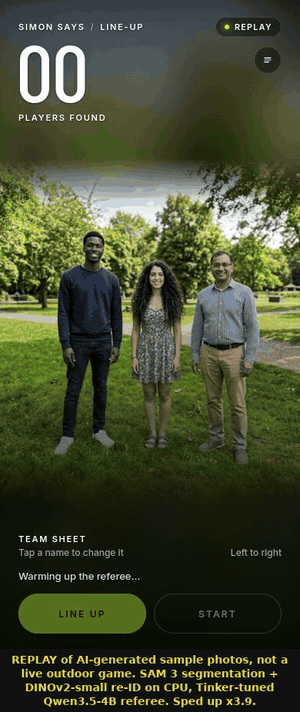
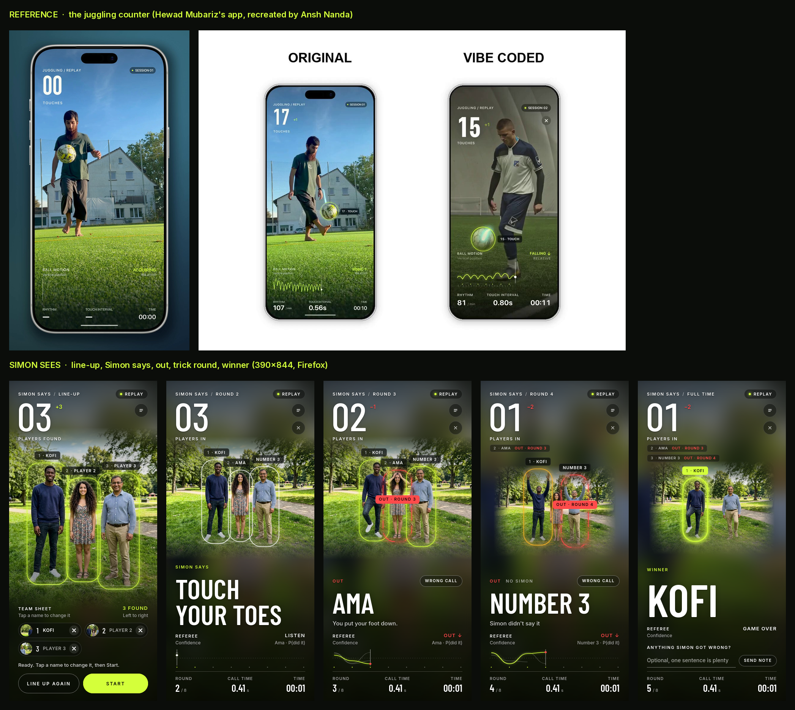

# Simon Sees

**Simon Says for a group of friends outdoors, refereed live by open models: a Qwen3.5-4B referee fine-tuned on Tinker, or Liquid's d1 entirely on your own laptop.**

Prop a phone on a stump. Step back. A voice calls *"Simon says stand on one foot"*, *"touch something green"*,
*"freeze"*, and sometimes just *"Hands on your head!"* with no Simon at all. A few seconds later:
*"Number 2, Simon didn't say! You're out."* Nobody looks at a screen until there's a winner.

<p align="center"></p>

<p align="center"><sub><b>Replay demo, not the field test:</b> the phone page at 390×844 playing a game over the AI-generated
sample photos in <code>samples/people</code>, with the real models on a 2-vCPU CPU: <code>facebook/sam3</code> (560 px) finds the
players, <code>facebook/dinov2-small</code> (the FALLBACK while the DINOv3 gate is pending) tells them apart, and
<code>LiquidAI/d1-omni-600M</code> judges each player's crop. The video is sped up; the decision table shown in the Ref's notes drawer holds the model's actual
probabilities. With sound: <a href="demo/simon-sees-demo.mp4">demo/simon-sees-demo.mp4</a> (Simon's voice is Kokoro TTS).
<!-- TODO(field test): add the real outdoor clip --></sub></p>

## How it works

```
 phone (browser)                          laptop (Python), or the GPU endpoint for the vision half
 ┌────────────────────┐   JPEG 640px      ┌───────────────────────────────────────────────────────┐
 │ camera, 3 fps      │ ────────────────▶ │ FastAPI + WebSocket · game engine · roster · voice     │
 │ speaker            │ ◀──────────────── │ SAM 3 ──▶ DINOv3 ──▶ match to line-up ──▶ d1 per crop  │
 │ (screen: setup only)│  Simon's voice    │ open TTS (Kokoro / Piper) · open STT · decisions.jsonl │
 └────────────────────┘                   └───────────────────────────────────────────────────────┘
```

Every frame batch goes through four steps (`simon_sees/pipeline.py`):

1. **Enrolment (the line-up).** Everyone stands in a row and you tap **Line up**. **SAM 3** segments every
   person in the frame with the text prompt `"person"`; each one becomes a **photo card**, numbered left to right.
   Type a name on a card or say it (faster-whisper); untouched cards stay *Player N* and Simon calls them
   *"Number N"*. Each player's masked crop is embedded with **DINOv3**: that vector is their identity.
   Nobody describes what they look like or what they wear; there is no text description of a person anywhere.
2. **Segmentation.** Each round, SAM 3 finds every person in the new frame (masks + boxes). Tiny far-away
   passers-by are dropped.
3. **Embedding match.** Each person's masked crop is embedded with DINOv3 and compared (cosine) with every
   player's small gallery: the line-up embedding plus a few confident sightings from the game, so the
   signature follows lighting and pose. A Hungarian assignment pairs players with people one-to-one, with a small
   bonus for staying in the same spot. Below the threshold a player is *not seen*, never guessed.
4. **Judging per crop.** Each matched player's own crop (background dimmed by the SAM mask so the
   neighbour doesn't count, grass and trees still visible) goes to the referee, the fine-tuned **Qwen3.5-4B** on
   Tinker (see *Best Use of Tinker* below) or **Liquid d1** locally, with one yes/no question:
   *"Look at the person in this photo. Is that person standing on one foot?"* **Freeze rounds** give d1 the same
   player's BEFORE and AFTER crops in one request: *"These two photos show the same person a moment apart. Did that
   person move?"* (A pixel-difference check inside the player's box runs alongside and is logged as a second
   opinion; it only decides with a model that can't take two images, and it is labelled `FALLBACK` in the log.)

**Rules**: Simon said it and P(did it) < 0.35 → out. Simon didn't say it and P(did it) > 0.65 → out. In between,
the referee isn't sure and gives the benefit of the doubt. A player who isn't matched in a frame is warned, never
eliminated. If everyone is caught at once, the round doesn't count. **Every decision is logged** to
`logs/decisions.jsonl` (models, per-player similarity, per-frame probabilities, latency per stage, verdict).

**Credit:** the segment-then-embed idea is the visual-search pattern Maziyar Panahi showed with DINOv3 + SAM 3.1
([post](https://x.com/MaziyarPanahi/status/2106368674500358351)): SAM 3.1 isolates each object, DINOv3 ranks the
others by visual similarity to a query. Here the query is each player's line-up photo.

### Models, and what happens when one isn't available

| step | preferred | fallback (labelled `FALLBACK` in logs, `/api/info` and the demo caption) |
|---|---|---|
| segment | `facebook/sam3` via transformers (CPU: 560 px input; GPU: 1008 px); `facebook/sam3.1` via Meta's repo on CUDA | `PekingU/rtdetr_r18vd` person boxes (ungated, no masks) |
| embed | DINOv3 `facebook/dinov3-vitb16-pretrain-lvd1689m` (gated) | `facebook/dinov2-small` (ungated) |
| judge (`--decider auto`) | Qwen3.5-4B + LoRA fine-tuned on Tinker, sampled on Tinker (when `SIMON_TINKER_MODEL` + `TINKER_API_KEY` are set) → the same weights locally (`SIMON_REFEREE_WEIGHTS`) | `LiquidAI/d1-3B` / `LiquidAI/d1-omni-600M` on your own machine |

`--segmenter auto --embedder auto --decider auto` (the default) tries the preferred model and falls back
automatically. Without a Tinker key or local referee weights, the judge is d1, exactly as before; the fallback is
logged. With the Tinker/Qwen referee, freeze rounds are judged by the pixel-difference check (that referee sees one
crop at a time); with d1, by d1's two-image question.

### Measured so far (CPU only)

On the 2-vCPU, 8 GB, no-GPU sandbox this was built in, with the 7 sample photos (`bench/results-sam3-cpu.md`):
SAM 3 at 560 px found the right number of people in 7 of 7 frames, at a median **16.6 s per frame**. With
DINOv2-small (DINOv3 was still gated for that account), re-identification was fully correct in 5 of 6 frames after
the line-up, **including the frame where all three players swapped places** (cosine 0.94–0.96 to the right
person), with no identity swaps; the one miss was a squatting player reported as *not seen* (cosine 0.30), which the
rules turn into a warning, not an elimination. These are 7 generated photos, not a field test or a benchmark.
In the recorded replay demo on the same box, one pose round took SAM 3 19.3 s for the frame, DINOv2 0.4 s, and
`LiquidAI/d1-omni-600M` 15.4 s for one batched call over the three players' crops (an earlier run of the same
pipeline measured 9.2–9.7 s per 3-crop batch); the demo is sped up x2.4 to fit in a minute. In that round
("Simon says put your hands on your head") d1 gave P = 0.12, 0.71 and 0.14, which matches the frame: only the
middle player had her hands on her head. On a CPU this is far too slow for live play: use a GPU laptop, a Mac
(`mps`), or the Modal backend below.

### Why a decision model and not a chatbot VLM

[Liquid AI's d1](https://huggingface.co/LiquidAI/d1-3B) (released Oct 7 2026) is a *decision model*: you give it a
state (here: one player's crop) and typed questions, and it returns **calibrated probabilities in one forward
pass with zero generated tokens**. A referee needs exactly that: a fast yes/no you can threshold, not a
paragraph. `bench/benchmark.py` measures it against a generative open VLM on the same crops.

```python
model.system_one(None, {
    "did": {"type": "noul", "instructions": "Look at the person in this photo. Is that person standing on one foot?",
            "criteria": {"true": "one foot clearly lifted off the ground", "false": "both feet on the ground"}},
}, images=[player_crop])
# {"answers": {"did": {"type": "noul", "noul": 0.97}}, "usage": {"input_tokens": ..., "output_tokens": 0}}
```


## Best Use of Tinker: a referee fine-tuned for exactly this question

d1 answers fast, but on this box the d1 that fits (`d1-omni-600M`) was wrong too often to referee a game: **63%** on
our human-checked test set, with 65 false "you did it" calls on 141 people who hadn't. So the referee was
fine-tuned on **[Tinker](https://thinkingmachines.ai/tinker/)**: a rank-32 LoRA on **Qwen3.5-4B** (open weights,
Apache-2.0), asked exactly the game's question for each crop, with P(yes) read from one token's logprobs.

**Test set: 222 COCO player crops, every label checked by eye, from 210 photos never used for training**
(`bench/results-tinker.md`):

| referee | accuracy | macro-F1 | false "did it" | missed |
|---|---|---|---|---|
| d1-omni-600M (CPU) | 63.1% | 0.629 | 65 | 17 |
| Qwen3.5-4B, untuned | 87.4% | 0.871 | 27 | 1 |
| Qwen3.6-35B-A3B, untuned | 88.7% | 0.882 | 19 | 6 |
| Qwen3.5-4B + LoRA, first run (v1) | 87.8% | 0.874 | 22 | 5 |
| **Qwen3.5-4B + LoRA, v2 (the referee)** | **93.2%** | **0.928** | **9** | **6** |

- **What made the difference: hard negatives.** The untuned model's mistakes were false positives on near-miss
  poses: a crouched skateboarder or a baseball slide "touching toes", cross-legged sitting "squatting", a cyclist
  "on one foot". The first fine-tune (v1) learned the easy cases, hit 100% on an easy val set, and didn't move on
  test. v2 added 720 near-miss negatives mined from COCO keypoints (`scripts/mine_hard_negatives.py`), halved the
  learning rate and dropped to 2 epochs: false positives 27 → 9, `touch_toes` 75% → 98%. Against the untuned 4B,
  exact McNemar p = 0.019; against the untuned 35B, v2 is ahead (18 vs 8 disagreements) but p = 0.08. One caveat:
  the near-miss categories were chosen after looking at v1's test errors (no test photo was used), so read the
  gain as somewhat optimistic.
- **Real game crops** (7 AI-generated sample photos, 119 crops, 9 yes): v2 98.3%, untuned 4B 99.2%, d1-omni-600M
  77.3%. Too small and easy to separate the Qwen models; it does show d1's false positives on the game's own crops.
- **Speed:** one batched Tinker call per round, ~2.9 s from this sandbox whether 1, 3 or 6 players (480 ms per crop
  at 6). d1-omni-600M on the 2-vCPU CPU: 2.7 s per crop, 7.9 s for a round of 3.
- **Cost:** ~$0.00006 per crop, about $0.004 for a 10-round game with 6 players at Tinker list prices. Both training
  runs plus all evaluation and the 35B label-cleaning teacher came to about $2 (estimated from logged tokens).
- **Data:** COCO 2017 keypoints (CC BY 4.0) → explicit geometric pose rules → crops cut exactly as the game cuts a
  player → train/val labels cleaned by agreement with the untuned 35B on Tinker; test labelled by hand. Details,
  licences and what failed (`hand_mouth`/`wave` dropped, thin rare-pose positives, an easy v1 val set):
  `data/README.md`, `bench/results-tinker.md`.

```bash
export TINKER_API_KEY=... SIMON_TINKER_MODEL=tinker://7bfed040-1481-5605-ad1f-a7cdee9763ca:train:0/sampler_weights/step0100
python -m simon_sees serve            # --decider auto picks the Tinker referee; unset the vars for local d1
```

A Tinker checkpoint is private to the account that trained it. To run the referee without Tinker,
`scripts/export_referee.py` downloads the LoRA (done here, 278 MiB) and converts/merges it for transformers + peft
or vLLM (`--decider local-qwen`, `docs/tinker.md`). That local path needs ~9 GB for the model and **was not tested
here** (8 GB RAM, no GPU).
\n## Quickstart\n
### Try it at a desk in one minute (no camera, no model)

```bash
git clone https://github.com/nice-bills/simon-sees && cd simon-sees
python -m venv .venv && source .venv/bin/activate
pip install -r requirements-dev.txt
python -m simon_sees dryrun --replay samples/people --segmenter mock --embedder mock --decider mock --fast
python -m pytest -q
```

### End-to-end tests of the phone page

The phone client is tested end to end with [e2e by TesterArmy](https://github.com/tester-army/e2e) (Playwright
under the hood), on a desktop window and a 390×844 phone viewport. The runner starts the real server in dry-run
mode (replayed frames, mocked segmenter/embedder, seeded mock decider), taps Line up, checks the name chips are
numbered left to right, starts a game, and asserts the rounds, an elimination and the winner with deterministic locators and assertions. An optional `agent.act` /
`agent.assert` test runs only when `AI_GATEWAY_API_KEY` is set (Vercel AI Gateway); otherwise it is skipped.

```bash
pip install -r requirements.txt
cd e2e && npm ci && npx e2e-web install chromium
SIMON_PYTHON=python3 npx e2e run            # both targets;  npx e2e run --target phone  for the phone only
```

CI (`.github/workflows/ci.yml`) runs pytest, a terminal dry run, and the e2e suite on every push and PR.
The demo above is recorded the same way: `cd e2e && npm run demo && python ../scripts/make_demo.py`.

With `--segmenter mock --embedder mock --decider mock` the "people" are vertical bands and the answers are
random: this shows the game loop, voice lines and logging. It says nothing about accuracy.

### The real thing: laptop + phone

```bash
pip install -r requirements-model.txt          # torch + transformers 5.17 (d1 needs >= 5.14, SAM 3 is in 5.x)
pip install -r requirements-extras.txt         # optional: Kokoro TTS, faster-whisper STT, Sentry
export HF_TOKEN=hf_...                         # accept the gates first: facebook/sam3 (and DINOv3, optional)
python -m simon_sees serve                     # downloads SAM 3, DINO and LiquidAI/d1-3B (~6 GB) on first run
cloudflared tunnel --url http://localhost:8000 # in a 2nd terminal: gives you an https URL
```

Open the `https://….trycloudflare.com` URL on the phone, turn the camera on, have everyone line up facing it,
tap **Line up**, name the photo cards if you like, tap **Start**.
Fully offline (phone hotspot + local HTTPS cert) and ngrok options: [docs/phone-setup.md](docs/phone-setup.md).

Desk demo with the real model and replayed frames (or your own video):

```bash
python -m simon_sees serve --replay samples/people            # open http://localhost:8000, the page plays from the replay
python -m simon_sees dryrun --replay my_clip.mp4 --names Kofi Ama ""   # line-up from the first frame; video needs opencv-python-headless
```

Useful flags: `--model LiquidAI/d1-omni-600M` (smaller, experimental), `--device cuda|mps|cpu`,
`--dtype bf16`, `--compile` (CUDA graphs on NVIDIA), `--indoors` (no grass/tree commands),
`--save-frames captures` (keep judged frames locally to label for the benchmark), `--tts browser`,
`--segmenter sam3|sam3.1|fallback`, `--embedder dinov3|dinov2`, `--match-threshold 0.45`.

### Playtesting: record, correct, upload

Every game is recorded on the laptop in `sessions/` (frames, per-player crops, per-stage timings, identity
scores, d1's answers, verdicts, errors; `SIMON_RECORD=0` turns it off). Players tap **Wrong call** on a verdict
or in Ref's notes, and leave a note at full time. `python -m simon_sees upload` sends the sessions to a private
Hugging Face dataset (`bundle` makes a zip instead). Step-by-step for a non-expert: [docs/playtest.md](docs/playtest.md),
or just `./run_playtest.sh`. On the analysis side: `scripts/pull_playtests.py`, `scripts/playtest_report.py`
(accuracy vs corrections, per-command errors, p50/p95 latency per stage, identity failures, crashes, notes) and
`scripts/export_labels.py` (crop + command + label JSONL, `source: model | human_correction`, for fine-tuning the referee).

### No GPU? Run the vision half on Modal

`deploy/modal_app.py` puts SAM 3.1 + DINOv3 + d1-3B behind one HTTPS endpoint on a Modal GPU; the game, roster,
voice and phone page stay on your laptop. Deploy it from your laptop (`modal deploy deploy/modal_app.py`), then
`export SIMON_VISION_URL=…` and `python -m simon_sees serve` uses it. Setup, auth and cost notes:
[docs/modal.md](docs/modal.md). It has not been deployed or timed yet; no GPU numbers are claimed here.

## The screen

The camera is the interface. The picture (in a replay, the exact frame the referee judged) fills the phone and
a thin HUD floats on it, in the style of the viral juggling-counter app: a huge condensed numeral for the
players still in, letter-spaced caps labels, one lime accent, scrims instead of panels. Every player gets a
glowing ring drawn from their SAM box with a name chip (`2 · AMA`); the ring's colour is the verdict (lime safe,
red out with the ring breaking, amber "Simon didn't say", dashed "lost you"). At the bottom: the call, then the
referee's confidence as a per-round sparkline, and `ROUND · CALL TIME · TIME`. Models, latencies and the
"Wrong call" controls live in a slide-up "Ref's notes" sheet. Fonts (Barlow Condensed + Inter, SIL OFL) are
self-hosted, so it works offline.



Direction and system: [docs/design/DIRECTION.md](docs/design/DIRECTION.md); every state at 390×844 in
[docs/design/hud/](docs/design/hud/).

## Hardware notes

| where | what to expect |
|---|---|
| NVIDIA GPU (RTX 4090) | Liquid reports 17 ms for a 384 px image with d1-3B ([model card](https://huggingface.co/LiquidAI/d1-3B)) |
| Apple Silicon (M5 Pro, `mps`) | Liquid reports 62 ms for a 384 px image |
| Jetson Orin Nano | Liquid reports 202 ms for a 384 px image |
| CPU only (2 vCPU, measured) | SAM 3 at 560 px: median 16.6 s per frame; DINOv2-small: ~0.3 s for 3 crops (`bench/results-sam3-cpu.md`); d1-omni-600M: `bench/results-sandbox-cpu.md` |

d1-3B needs ~6.3 GB in bf16 (12.5 GB in fp32, the card's CPU default). On a 16 GB Mac use `mps` (bf16).
A pose round is one SAM + DINO pass per frame plus one d1 call per seen player per frame, all batched; Simon gives
players a ~2 s beat anyway, so anything under ~500 ms per batch feels instant. SAM 3 and the d1 numbers above are
separate models: the GPU rows are Liquid's d1 figures only, not the whole pipeline.

## Why open, local AI matters here

- **Privacy**: it's a camera pointed at your friends. With the laptop setup, no video frame leaves the
  devices you own: no cloud vision API, no account, no upload. Frames live in memory and are dropped;
  saving them is opt-in. Identities are DINO vectors held in memory for one game, never names-to-faces in a
  database. (The optional Modal backend sends frames to your own Modal workspace; see docs/modal.md. The Tinker
  referee sends each player's dimmed crop, not the frame, to Tinker for one yes/no answer; for a fully local game
  leave `SIMON_TINKER_MODEL` unset or use the local referee weights.)
- **Works where games happen**: parks and beaches have bad signal. Weights download once; the phone
  can join the laptop's hotspot with mobile data off.
- **Free to run**: an afternoon of Simon Says is thousands of vision decisions. Locally that costs a
  laptop battery, not an API bill.
- **Hackable**: commands are plain-English questions in `simon_sees/commands.py`. Add *"touch your
  nose"* in one line; swap models with `--model`.

## Project layout

```
simon_sees/
  engine.py        game loop + rules (pure judge() function), line-up → players
  vision.py        SAM 3 / SAM 3.1 / FALLBACK detector segmenters, DINOv3 / DINOv2 embedders, mocks, person crops
  identity.py      enrolment numbering, per-player galleries, Hungarian matching (who is who)
  pipeline.py      one frame batch: segment → embed → match → d1 per crop; local or remote (Modal) backend
  decider.py       d1 wrapper (system_one_batch), question builders, referee picking (auto), mock for tests
  tinker_referee.py the fine-tuned Qwen3.5-4B referee: prompt, Tinker sampling, local transformers+peft
  pose_rules.py    COCO keypoints -> pose labels for the referee's training data
  commands.py      the command list: spoken text + the visual yes/no check
  motion.py        FALLBACK pixel-difference motion check
  server.py        FastAPI: phone page, WebSocket frames in / voice out, /api/stt
  voice.py         Kokoro/Piper TTS, faster-whisper STT, spoken-name parsing
  replay.py        dry-run camera: a folder of images or a video
  tracing.py       optional Sentry gen_ai spans
  recorder.py      playtest session recorder (sessions/<time>-<id>/)
  upload.py        `upload` (private HF dataset) and `bundle` (zip) for recorded sessions
  playtest_data.py reading sessions back (report + label export)
  static/          the phone page (vanilla JS, no build step)
bench/benchmark.py d1 vs generative VLM: accuracy + latency → CSV + markdown table
bench/sam3_cpu_reid.py  SAM 3 person counts + latency and DINO re-identification on samples/people
bench/referee_*.py      referee evaluation, report and latency (results-tinker.md)
data/              referee test set (human-verified) + real-game slice; README: data pipeline + licences
deploy/modal_app.py     the GPU endpoint (SAM 3.1 + DINOv3 + d1-3B) for --backend modal
scripts/           sample-frame generator, log summarizer, demo video builder, playtest pull/report/export
tests/             pytest: engine rules, enrolment + re-identification, full mocked games, server WebSocket,
                   the remote-vision client against a mocked HTTP endpoint
e2e/               e2e (TesterArmy) tests of the phone page: desktop + phone viewport, plus the demo recorder
demo/              the replay demo (MP4 with voice, GIF)
docs/              phone setup, Modal + DigitalOcean GPU deploys, the DEV post draft, design/ (UI direction, renders)
```

## Optional: DigitalOcean GPU + Sentry tracing

No GPU laptop? [docs/deploy-digitalocean.md](docs/deploy-digitalocean.md) runs the same Docker image on a
DigitalOcean GPU Droplet. Set `SENTRY_DSN` to get one `gen_ai.invoke_agent` transaction per round and one
`gen_ai.evaluate` span per d1 call (latency, tokens; never images). Both are off by default and the local
run never needs them.

## Licence

- **Code**: MIT (see `LICENSE`).
- **Model weights** are not in this repo. `LiquidAI/d1-3B` and `LiquidAI/d1-omni-600M` are published by
  Liquid AI under the **LFM Open License v1.0** (`license: other`, `license_name: lfm1.0` on the model
  cards). In short: free to use, modify and redistribute, including commercially, **as long as the
  commercial user's annual revenue is under US$10 million**; above that threshold commercial use is not
  licensed (qualifying non-profits doing non-commercial/research work are exempt from the threshold).
  Read the full text in the model repo's `LICENSE` before you build on it.
- **SAM 3 / SAM 3.1** (`facebook/sam3`, `facebook/sam3.1`) are gated and released by Meta under the SAM License;
  **DINOv3** is gated under the DINOv3 License; **DINOv2** and **RT-DETR** (`PekingU/rtdetr_r18vd`) are Apache-2.0.
  Accept each gate on Hugging Face and read its terms before you use it.
- **The fine-tuned referee** is a LoRA on `Qwen/Qwen3.5-4B` (Apache-2.0), trained on COCO annotations (CC BY 4.0)
  and Flickr images under their own CC licences, many of them non-commercial; the weights are not in this repo.
- **Fonts** (self-hosted in `simon_sees/static/fonts/`): Barlow Condensed and Inter, both SIL Open Font License 1.1
  (`OFL-Barlow.txt`, `OFL-Inter.txt`).
- Optional components carry their own licences: Kokoro-82M (Apache-2.0), Piper voices (per voice),
  Whisper / faster-whisper (MIT).
